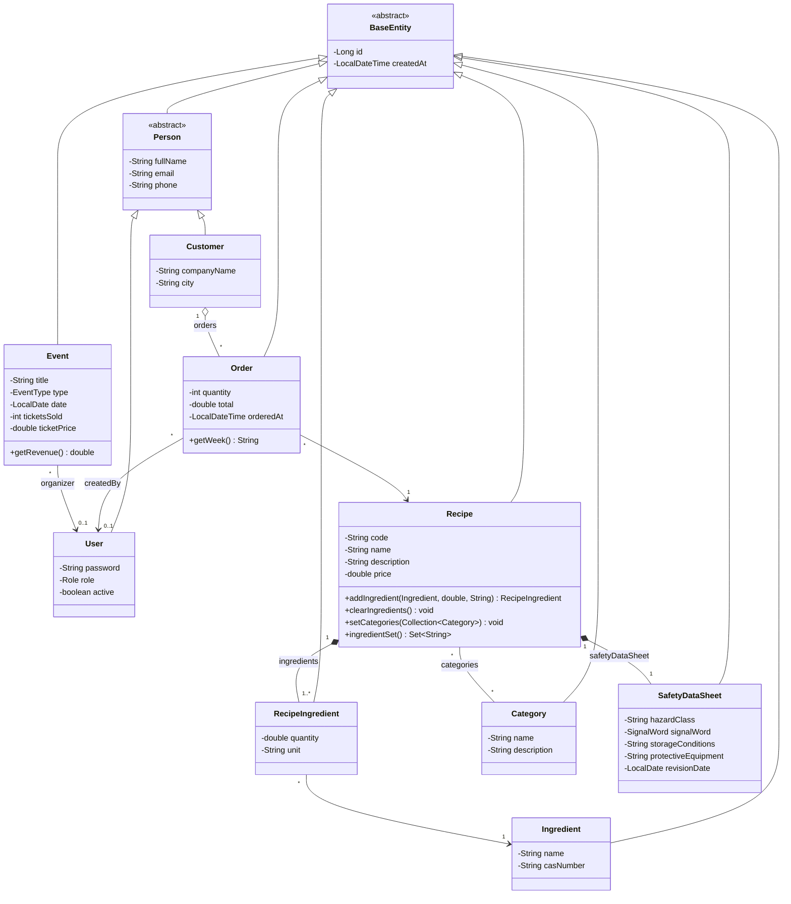

# Chemical Recipe Management System

A small Spring Boot **MVC** app: Java 21, Spring MVC + Thymeleaf (views), Spring Data JPA + H2 (database), OpenPDF (PDF reports).

## Run

```bash
./mvnw spring-boot:run        # Windows: mvnw.cmd spring-boot:run
```

Open http://localhost:8080 and log in:

| Email | Password | Role |
|---|---|---|
| admin@crms.local | Admin123! | ADMIN |
| chemist@crms.local | Pass123! | CHEMIST |
| technician@crms.local | Pass123! | TECHNICIAN |
| vet@crms.local | Pass123! | VET |
| reception@crms.local | Pass123! | RECEPTION |

Demo data comes from `MockData.java` and is saved in `data/`. Delete `data/` to start fresh.

> **Upgrading from an older version?** The database tables changed (new entities and relations). Stop the app and delete everything in `data/` except `.gitkeep` once, otherwise startup fails.
Tests: `./mvnw test`

## Project structure (MVC)

```text
src/main/java/org/codingburgas/ChemicalRecipeSystem
├── config/         PasswordConfig (BCrypt), WebConfig (login + role checks)
├── controllers/    receive requests, call services, pick a view (work only with DTOs)
├── dto/            UserDto, UserForm, ProfileForm, RecipeDto, RecipeForm, RecipeIngredientDto,
│                   SafetyDataSheetDto, CategoryDto, OrderDto, EventDto, PeriodReport, ReportRow, DtoMapper
├── models/         JPA entities: BaseEntity, Person, User, Customer, Recipe, RecipeIngredient,
│                   Ingredient, Category, SafetyDataSheet, Order, Event + enums Role, EventType, SignalWord
├── repositories/   Spring Data JPA interfaces (no SQL by hand)
├── services/       all business logic (entities in, DTOs out)
├── ChemicalRecipeSystem.java   main class
└── MockData.java               demo data on first start
src/main/resources
├── templates/      Thymeleaf views (HTML)
├── static/css/     style.css
└── application.properties
```

Request flow: **Controller → Service → Repository → database**. The service converts entities to **DTOs** (`DtoMapper`) and the controller sends the DTOs to a **View** (template).

## Domain model



| Relationship | Kind | Cardinality | JPA / Hibernate mapping |
|---|---|---|---|
| `BaseEntity` → `Person` → `User`, `Customer`; `BaseEntity` → all other entities | Inheritance | – | `@MappedSuperclass` (id + createdAt, contact fields) |
| `Recipe` → `RecipeIngredient` | Composition (lines can't exist without the recipe) | One-to-Many | `@OneToMany(mappedBy, cascade = ALL, orphanRemoval = true)` + `@ManyToOne` back |
| `Recipe` → `SafetyDataSheet` | Composition | One-to-One | `@OneToOne(cascade = ALL, orphanRemoval = true)` + unique `@JoinColumn` |
| `Recipe` ↔ `Category` | Association | Many-to-Many | `@ManyToMany` + `@JoinTable(recipe_category)`, inverse side `mappedBy` |
| `Recipe` ↔ `Ingredient` (through `RecipeIngredient`, with quantity + unit) | Association | Many-to-Many | join entity with two `@ManyToOne` |
| `Customer` → `Order` | Aggregation (orders have their own life, no cascade) | One-to-Many | `@OneToMany(mappedBy = "customer")` + `@ManyToOne(optional = false)` |
| `Order` → `Recipe` | Association | Many-to-One | `@ManyToOne(optional = false)` |
| `Order` → `User` (createdBy), `Event` → `User` (organizer) | Association | Many-to-One | `@ManyToOne` |

**Access levels:** all fields are `private`; entities expose `public` getters/setters, collections are returned read-only (`Collections.unmodifiable...`) and changed only through methods like `Recipe.addIngredient()`. The `RecipeIngredient` constructor is package-private (only `Recipe` creates lines), JPA no-arg constructors are `protected`, `BaseEntity` and `Person` are `abstract`.

## DTOs

Views never receive entities. Services return DTOs built by `DtoMapper` inside a transaction, so there are no lazy-loading errors in templates and no internal fields leak to the UI:

- **Read DTOs** – `UserDto` (no password hash; this is what is kept in the HTTP session), `RecipeDto` with `RecipeIngredientDto` / `SafetyDataSheetDto`, `CategoryDto`, `OrderDto` (recipe / customer / employee names instead of entities), `EventDto`, `PeriodReport` / `ReportRow`.
- **Form DTOs** – `UserForm` (create user), `ProfileForm` (edit profile), `RecipeForm` (create / edit a recipe with ingredient lines, categories and safety data sheet). Controllers bind these with `@ModelAttribute` instead of binding entities.

## Where each task is

| Task | Code | Page |
|---|---|---|
| Admin searches users/members, sorting + pagination | `UserService.search`, `UserRepository.search`, `UserController.list` | `/admin/users` |
| Filter and sort orders by week, date, day, hour | `OrderService.filterAndSort` | `/orders` |
| Reports module: from/to period + group by (day/week/month/year) | `ReportService.build` | `/reports` |
| Reports for 1 / 6 / 12 months with a calendar; events count, types and money collected | `ReportService.monthly`, `ReportService.calendar` | `/reports/monthly` (the **Open reports** button on the dashboard) |
| Accounting reports as PDF: view or download | `PdfService.create`, `ReportController.pdf` | **View PDF** / **Download PDF** buttons |
| Create users (ADMIN, CHEMIST, TECHNICIAN, VET, RECEPTION), update profile (name, email, phone), deactivate (soft delete), manage roles (admin only) | `UserService.create / updateProfile / setActive / changeRole` | `/admin/users/new`, `/admin/users/{id}`, `/profile` |
| New registrations today / week / month / year | `UserService.registrationCounts / registeredSince / registrationsPerMonth` | `/admin/users/registrations` |
| Recipes with ingredient lines (quantity + unit), categories and a safety data sheet | `RecipeService.save`, `RecipeForm`, `DtoMapper` | `/recipes`, `/recipes/new`, `/recipes/{id}/edit` |
| Methods for intelligent systems | `IntelligenceService`: linear-regression forecast, z-score anomaly detection, Jaccard similarity recommendations, rule-based expert system | `/insights` |

## Access rules (`WebConfig`)

- Every page needs a logged-in user (a `UserDto` stored in the HTTP session).
- `/admin/**` is only for ADMIN.
- Creating/editing recipes is only for ADMIN and CHEMIST.
- A deactivated user cannot log in. An admin cannot deactivate themselves or remove their own ADMIN role.
