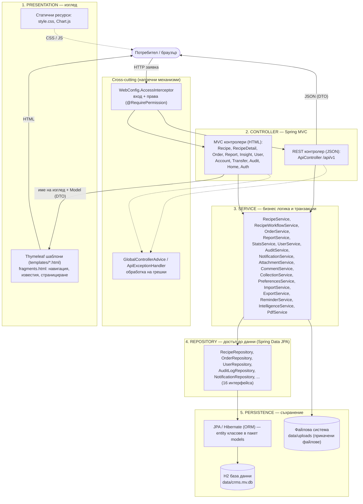
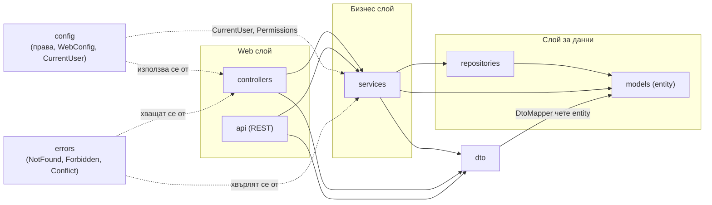
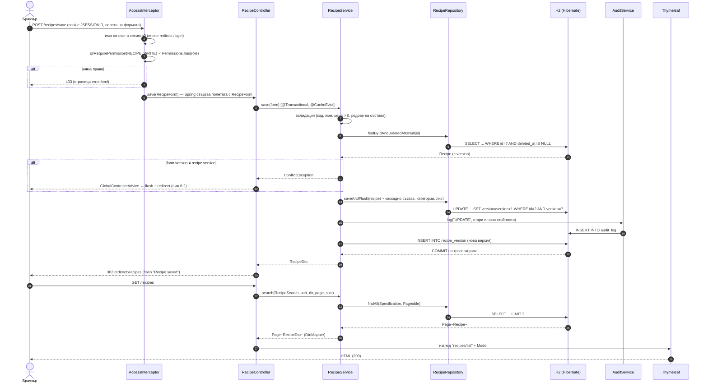
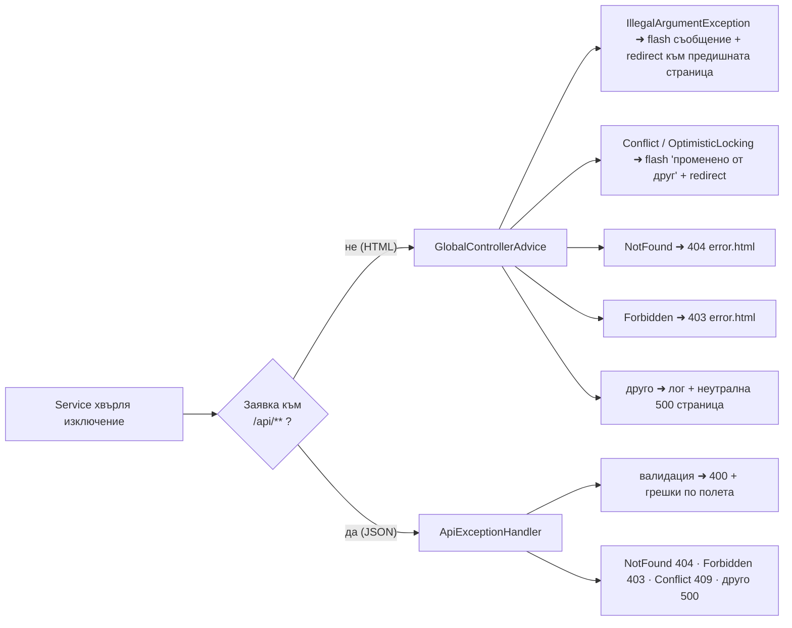
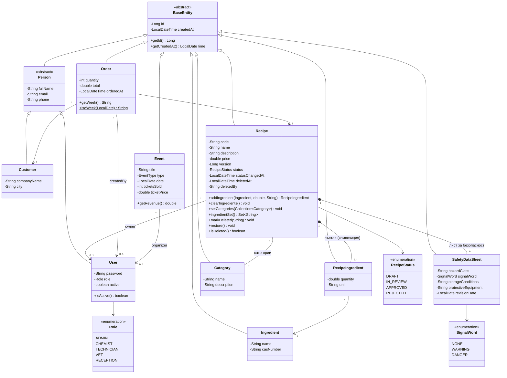
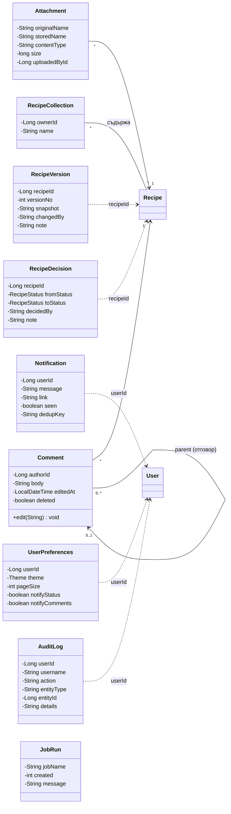
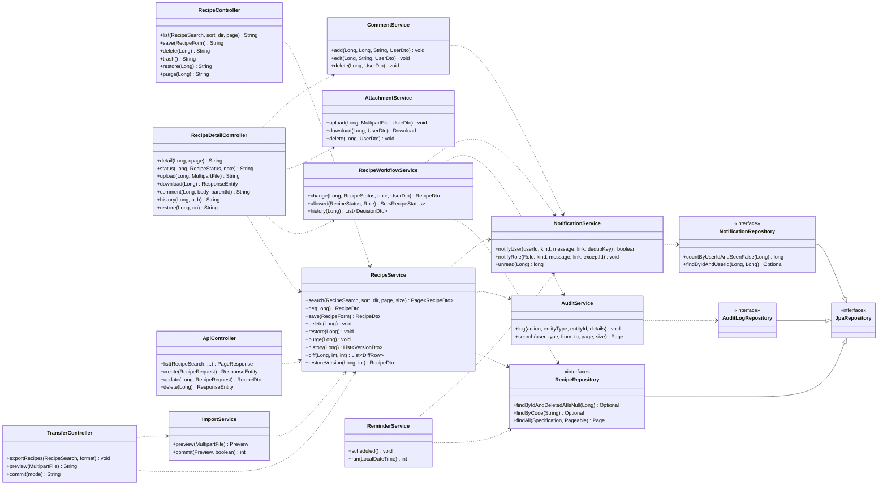
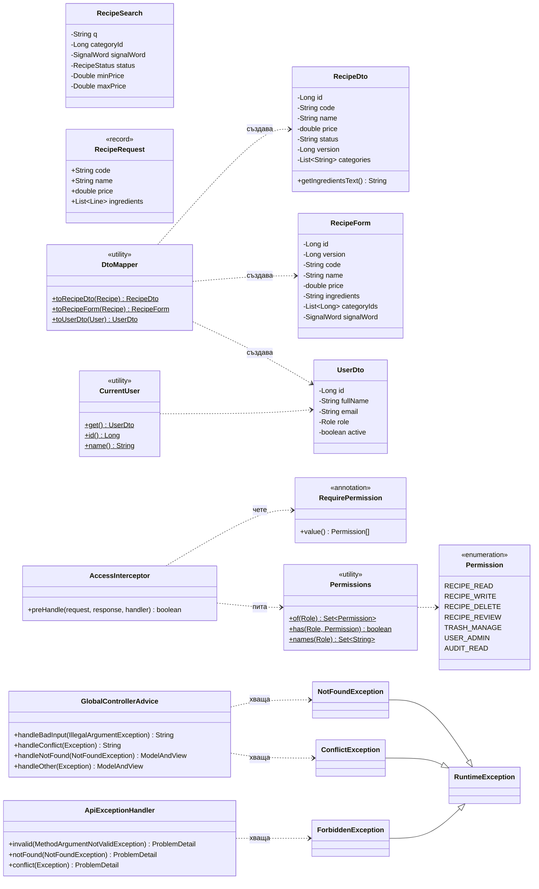

# Архитектура на Chemical Recipe Management System (CRMS)

Документът описва архитектурата на реалното приложение в това хранилище: **Java 21, Spring Boot 4 (Spring MVC), Thymeleaf, Spring Data JPA, H2**. Всички диаграми са в Mermaid (визуализират се директно в GitHub); PNG версии има в `docs/diagrams/`.

**Какво прави системата:** управление на химични рецепти (състав, категории, информационен лист за безопасност), поръчки и събития, отчети и статистика, одобряване на рецепти (работен процес), версии, коментари, известия, импорт/експорт и REST API. Работи с роли (ADMIN, CHEMIST, TECHNICIAN, VET, RECEPTION).

---

## 1. Архитектурни слоеве

Приложението е **монолит със слоеста архитектура (Layered Architecture)**, а в горната част слоевете следват шаблона **MVC** (Model – View – Controller).

| Слой | Отговорност | Пакет / ресурси |
|---|---|---|
| **Presentation** | Изгражда HTML от данните в модела; никаква бизнес логика | `resources/templates`, `resources/static` |
| **Controller** | Приема HTTP заявка, свързва параметрите с обект (form/DTO), вика **един** сервиз, избира изглед или пренасочване | `controllers`, `api` |
| **Service** | Цялата бизнес логика: валидация, правила, транзакции (`@Transactional`), одит, известия, кеш | `services` |
| **Repository** | Заявки към базата през интерфейси на Spring Data (без ръчен SQL; `Specification` за динамични филтри) | `repositories` |
| **Persistence** | Превръща обекти в редове (Hibernate), H2 файл като база, диск за качени файлове | `models` (entity), H2, `data/` |

---

## 2. Взаимодействие между слоевете и посока на зависимостите

**Правило: зависимостите сочат само надолу.** Горният слой знае за долния, никога обратно. Проверено по кода:

* `controllers` и `api` **не** импортират нито един клас от `repositories` (общуват само със сервизи);
* `services` **не** импортират `controllers`; `repositories` **не** импортират `services`; `models` не зависи от нито един друг слой (с изключение на самия JPA);
* между контролер и сервиз се движат **DTO/форми** (`RecipeDto`, `RecipeForm`, `UserDto`, `RecipeSearch`), а не entity класове — изгледът не може да задейства lazy loading и не вижда вътрешния модел (напр. хеша на паролата).

| От ➜ към | Разрешено? | Забележка |
|---|---|---|
| controllers ➜ services, dto, config, errors | да | единственият начин да се стигне до данните |
| controllers ➜ repositories | **не** | няма такъв import в кода |
| services ➜ repositories, models, dto, config, errors | да | сервизите оркестрират хранилищата |
| services ➜ controllers | **не** | |
| repositories ➜ models | да | `JpaRepository<Recipe, Long>` |
| repositories ➜ services | **не** | |
| models ➜ всичко останало | **не** | модел без зависимости |

Допълнение: `MockData` (в корена на пакета) е `CommandLineRunner`, който при първо стартиране зарежда демо данни; той е инфраструктурен и затова работи и през сервизи, и директно с хранилища.

---

## 3. Обосновка на избрания подход

Избрани са **Layered Architecture + MVC (Spring MVC) в един монолитен Spring Boot модул**, допълнен с REST API върху същите сервизи.

1. **Съответствие на проблема.** Системата е CRUD-ориентирана с богат домейн (рецепти ↔ състав ↔ категории ↔ информационен лист) и прости до средни правила. Слоестата архитектура пасва точно: всеки слой има една отговорност.
2. **Транзакционна цялост.** Запис на рецепта променя няколко таблици (рецепта, състав, категории, лист за безопасност, версия, одит, известие). В един процес и една транзакция (`@Transactional` в `RecipeService`) това е атомарно; при разпределена система би изисквало саги/компенсации.
3. **MVC чрез Thymeleaf.** Сървърно рендиране — по-проста сигурност (няма токени в браузъра), по-малко код, достъпност и работа без JavaScript. Графиките (Chart.js) са единственото клиентско усложнение.
4. **Тестваемост.** Правилата са в сервизите; `MockMvc` тестове покриват HTTP + права, а сервизни тестове — логиката (общо 40 автоматични теста, изпълнявани от CI).
5. **Поддръжка и размер на екипа.** Малък екип/ученически проект: един артефакт за стартиране (`./mvnw spring-boot:run`), без инфраструктура (H2 файл).
6. **Разширяемост.** Новият REST API (`/api/v1`) не дублира логика — вика същите сервизи. Ако е нужен друг клиент (мобилно приложение), слоевете не се променят.

---

## 4. Структура на пакетите и отговорности

Основен пакет: `org.codingburgas.ChemicalRecipeSystem`

| Пакет | Основни компоненти | Отговорност |
|---|---|---|
| `controllers` | `RecipeController` (списък/форма/запис/изтриване/кошче), `RecipeDetailController` (детайл, статус, файлове, коментари, история), `OrderController`, `ReportController` (+PDF), `InsightController`, `UserController` (/admin/users), `AccountController` (списъци, известия, настройки), `TransferController` (експорт/импорт), `AuditController`, `HomeController` (табло), `AuthController` (вход/профил), `GlobalControllerAdvice` | HTTP вход/изход, избор на изглед, пренасочвания, flash съобщения |
| `api` | `ApiController` (`/api/v1/recipes`, `/orders`), `RecipeRequest` (record с Bean Validation), `ApiExceptionHandler` | JSON интерфейс с коректни HTTP статуси |
| `services` | `RecipeService`, `RecipeWorkflowService`, `AuditService`, `NotificationService`, `ReminderService` (`@Scheduled`), `AttachmentService`, `CommentService`, `CollectionService`, `PreferencesService`, `ImportService`, `ExportService`, `StatsService`, `ReportService`, `OrderService`, `UserService`, `IntelligenceService`, `PdfService` | Бизнес правила, транзакции, кеширане, одит |
| `repositories` | `RecipeRepository` (+`JpaSpecificationExecutor`), `OrderRepository`, `UserRepository`, `AuditLogRepository`, `NotificationRepository`, `CommentRepository`, … | Достъп до данни, заявки |
| `models` | `BaseEntity` ◀ `Person` ◀ `User`/`Customer`; `Recipe`, `RecipeIngredient`, `Ingredient`, `Category`, `SafetyDataSheet`, `Order`, `Event`, `AuditLog`, `RecipeVersion`, `RecipeDecision`, `Notification`, `Attachment`, `Comment`, `RecipeCollection`, `UserPreferences`, `JobRun` + енумерации | Домейн модел и JPA съпоставяне |
| `dto` | `RecipeDto`, `RecipeForm`, `RecipeSearch`, `UserDto`, `OrderDto`, `PeriodReport`, `DtoMapper` и др. | Данни между слоевете; `DtoMapper` превръща entity ➜ DTO |
| `config` | `WebConfig` (+`AccessInterceptor`), `Permission`, `Permissions`, `@RequirePermission`, `CurrentUser`, `PasswordConfig` (BCrypt), `AppConfig` (кеш, планировчик) | Сигурност и инфраструктурна конфигурация |
| `errors` | `NotFoundException`, `ForbiddenException`, `ConflictException` | Типизирани бизнес грешки |

---

## 5. Проследяване на една реална заявка

**Сценарий: химикът редактира рецепта и натиска „Save recipe“** (`POST /recipes/save`), след което вижда списъка.

**Стъпките с думи:**

1. Браузърът изпраща формата. 2. `AccessInterceptor` (преди контролера) проверява сесията и правата. 3. Spring MVC превръща параметрите в `RecipeForm`. 4. Контролерът вика само `RecipeService`. 5. Сервизът валидира, зарежда рецептата (само неизтрита) и сравнява `version` (оптимистично заключване). 6. Хранилището записва; Hibernate изпраща `UPDATE … WHERE version=?`. 7. В същата транзакция се записват одит и нова версия, а кешът на отчетите се изчиства. 8. Връща се `RecipeDto`; контролерът пренасочва (**Post/Redirect/Get** — няма повторно изпращане при F5). 9. Новият `GET /recipes` връща страница от резултати през `Specification`, превърната в DTO, и Thymeleaf рисува HTML.

---

## 6. Валидация, обработка на изключения и контрол на достъпа

### 6.1 Валидация (на няколко нива)

| Ниво | Механизъм | Пример |
|---|---|---|
| Браузър (UX) | HTML5 атрибути | `required`, `type="email"`, `min`, `minlength`, `accept=".pdf,.png,.jpg"` |
| Свързване на данни | Spring конверсия на типове | невалиден enum/число ➜ HTTP 400 |
| **Бизнес правила (сервиз)** | проверки в сервизите, хвърлят `IllegalArgumentException` | код/име задължителни, цена > 0, поне една съставка, дублиран код, невалиден преход на статус, коментар 1–2000 знака |
| REST входни данни | **Bean Validation** (`@Valid`, `@NotBlank`, `@Positive`, `@NotEmpty`) върху `RecipeRequest` | отговор 400 със списък от грешки по полета |
| Файлове | `AttachmentService`: размер ≤ 5 MB, разширение **и** сигнатура на файла (PDF/PNG/JPG), безопасно име, случайно име на диска | преименуван `.exe`/фалшив `.pdf` се отхвърля |
| База данни | ограничения: `UNIQUE(code)`, `UNIQUE(email)`, външни ключове, `UNIQUE(recipeId, versionNo)`, `UNIQUE(userId, dedupKey)` | последна защита дори при грешка в кода |
| Изход | Thymeleaf `th:text` екранира HTML (XSS); експортът неутрализира формули (`=`, `+`, `-`, `@`) | |

### 6.2 Обработка на изключения

Грешките се хвърлят в сервизите и се **превръщат в отговор на едно централно място**; потребителят никога не вижда stack trace (`server.error.include-stacktrace=never`).

| Изключение | Уеб (HTML) | REST (JSON, ProblemDetail) |
|---|---|---|
| `IllegalArgumentException` (невалидни данни) | съобщение на същата страница | 400 |
| `MethodArgumentNotValidException` | — | 400 + грешки по полета |
| `NotFoundException` | страница 404 | 404 |
| `ForbiddenException` / липсващо право | страница 403 | 403 |
| `ConflictException`, `ObjectOptimisticLockingFailureException` | съобщение + презареждане на актуалните данни | 409 |
| неочаквана грешка | лог + страница 500 (без подробности) | 500 |
| неавтентикиран | redirect към `/login` | 401 |

### 6.3 Контрол на достъпа

1. **Автентикация:** форма за вход ➜ `UserService.login` (само активни потребители, пароли с **BCrypt**) ➜ `UserDto` в `HttpSession`; сесията е само в бисквитка (`tracking-modes=cookie`).
2. **Авторизация (на сървъра):** `AccessInterceptor` се изпълнява преди всеки контролер и проверява `@RequirePermission` на метода; `/admin/**` изисква `USER_ADMIN`. Скритите бутони в интерфейса (`can.contains(...)`) са само удобство — истинската защита е на сървъра, затова ръчно направена HTTP заявка също получава 403.
3. **Права на ниво запис:** `AttachmentService` (файл — само качилият или редактор), `CommentService` (коментар — автор или администратор), `NotificationRepository.findByIdAndUserId` и `CollectionRepository.findByIdAndOwnerId` (само собствени данни).
4. **Работен процес:** преходи към APPROVED/REJECTED изискват `RECIPE_REVIEW`.

| Роля | RECIPE_READ | RECIPE_WRITE | RECIPE_DELETE | RECIPE_REVIEW | TRASH_MANAGE | USER_ADMIN | AUDIT_READ |
|---|:-:|:-:|:-:|:-:|:-:|:-:|:-:|
| ADMIN | ✓ | ✓ | ✓ | ✓ | ✓ | ✓ | ✓ |
| CHEMIST | ✓ | ✓ | ✓ | | | | |
| TECHNICIAN / VET / RECEPTION | ✓ | | | | | | |

---

## 7. Анализ на архитектурни решения

Разгледани са три подхода.

| Критерий | **A. Layered + MVC монолит (избран)** | B. Хексагонална / Clean Architecture | C. Микросервизи + отделен SPA (React/Angular) |
|---|---|---|---|
| Сложност за този обем | ниска, познати правила | средна: портове, адаптери, mapping между модели | висока: мрежа, deployment на няколко услуги, API gateway |
| Транзакции между рецепта, одит, версия, известие | една ACID транзакция | една транзакция | разпределени (саги), риск от несъгласуваност |
| Скорост на разработка | най-бърза (Spring Boot, Thymeleaf, Spring Data) | по-бавна — повече интерфейси и класове | най-бавна — два проекта, договори между услугите |
| Тестваемост | добра (MockMvc + сервизни тестове) | отлична (домейнът е изолиран от рамката) | добра по услуги, трудна интеграционна |
| Сигурност | сесия + проверка на сървъра, без токени в браузъра | както A | токени (JWT), CORS, повече повърхност за атака |
| Стартиране/хостинг | един процес, H2 файл | един процес | Docker/оркестрация, няколко бази |
| Мащабируемост | вертикална, достатъчна за стотици потребители | както A | най-добра хоризонтална |
| Риск от „преинженерство“ | няма | среден | много висок |

**Защо A е подходящ за конкретната система:**

* Потребителите са десетки (лаборатория, ветеринарна, рецепция), а не милиони — хоризонталното мащабиране на C не носи полза, а разходът му е голям.
* Данните са силно свързани (рецепта ↔ състав ↔ поръчки ↔ отчети); една база и една транзакция са естествени. При C трябва да се разделят по услуги и да се синхронизират.
* Приложението е в учебна среда: цялото се стартира с една команда и е лесно за поддръжка и защита.
* Основните предимства на B (изолиран домейн, лесна замяна на рамката/базата) се постигат частично и в A чрез интерфейсите на хранилищата (Spring Data) и DTO слоя, без допълнителните „портове“. Ако домейнът нарасне значително или се налага смяна на технологията, миграция към B е естествената следваща стъпка.
* Проблемът с различни клиенти е решен без C: `ApiController` предлага JSON върху същите сервизи (хибрид MVC + REST).

---

## 8. UML Class Diagram

### 8.1 Домейн модел (ядро)

### 8.2 Домейн модел (поддържащи функции)

### 8.3 Контролери, сервизи и хранилища (основни зависимости)

### 8.4 DTO и напречни механизми (сигурност, грешки)

---

## 9. Ограничения и възможни подобрения (честна оценка)

* **Няма CSRF защита** — приложението използва собствена сесийна автентикация вместо Spring Security. За реална експлоатация се препоръчва Spring Security със CSRF токени.
* **Сесиите са в паметта** на процеса и H2 е файлова база — подходящо за един сървър; за няколко инстанции трябва споделена сесия (Redis) и сървър за база (PostgreSQL).
* **Отклонение от DTO правилото:** страницата за одитния журнал получава `AuditLog` (само за четене) направо от сервиза; за пълно съответствие трябва `AuditDto`.
* **Настройваеми преходи на работния процес** са в карта в кода (`RecipeWorkflowService.TRANSITIONS`), не във външен файл.
* Интерфейсът е само на английски (няма превключване на език).
* Кешът е прост (`ConcurrentMapCache`, без TTL) и се изчиства при промяна на рецепти.

---

## 10. Файлове с диаграмите

Изображенията (`docs/diagrams/`) са за вмъкване в документ или презентация; източникът им е Mermaid кодът по-горе.

| Файл | Съдържание | Раздел |
|---|---|---|
| `01-sloeve.png` | Архитектурни слоеве | 1 |
| `02-zavisimosti.png` | Посока на зависимостите между пакетите | 2 |
| `03-posledovatelnost.png` | Sequence диаграма на заявка (запис на рецепта) | 5 |
| `04-izkluchenia.png` | Обработка на изключения | 6.2 |
| `05-class-domain-core.png` | UML Class: домейн ядро | 8.1 |
| `06-class-domain-support.png` | UML Class: поддържащи entity | 8.2 |
| `07-class-layers.png` | UML Class: контролери, сервизи, хранилища | 8.3 |
| `08-class-dto-security.png` | UML Class: DTO, сигурност, грешки | 8.4 |
